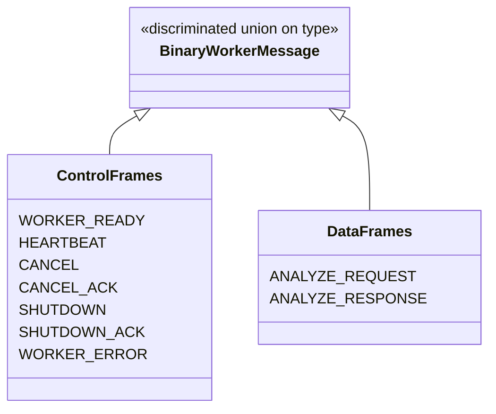

# REA Phase 3A — Milestone 1: Secure Binary Worker IPC Protocol Report
## Engineering Implementation, Formal Protocol Specification, and Verification

**Platform:** Reverse Engineering Assistant (REA)  
**Component:** Embedded Binary Security Investigation Pipeline — Multi-Process Isolation  
**Phase:** Phase 3A (Multi-Process Binary Analysis Architecture)  
**Milestone:** Milestone 1 — Secure IPC Protocol Contracts & Streaming Message Framer  
**Status:** COMPLETE (All 21 Protocol Tests Passing, 217 Binary Suite Tests Passing, Static Analysis & Lint Clean)  
**Date:** November 2026  

---

## 1. Executive Summary & Milestone Scope

Following the successful completion of Sprint 3B (Trusted Analysis Evidence Architecture) and Sprint 3B.1 (Independent Security Acceptance Audit), REA established cryptographic binding and HMAC-SHA256 non-repudiation for analysis evidence within the Node.js runtime. However, the Phase 3A architectural assessment identified that single-process in-memory isolation is fundamentally vulnerable to process memory corruption, heap exhaustion, and prototype pollution when untrusted firmware binaries are parsed.

In accordance with the authoritative blueprint documented in [`docs/phase-3A-multiprocess-architecture.md`](file:///c:/Users/acer/rea/docs/phase-3A-multiprocess-architecture.md), Phase 3A transitions REA from single-process analysis to a multi-process supervisor-worker topology.

**Milestone 1** executes the foundational requirement of this architecture: **Secure IPC Protocol Contracts and Bounded Message Framing**.

### Milestone 1 Boundaries
- **Delivered in Milestone 1:**
  1. Strict Zod schemas for all parent-worker IPC request, response, and control frames.
  2. Untrusted Data Transfer Object (DTO) contracts for raw analysis outputs (disassembly, CFG, reachability, taint, witness).
  3. Strict enforcement of authority boundaries: child workers are completely barred from signing evidence or awarding authoritative vulnerability verdicts (`VERIFIED` / `FALSE_POSITIVE`).
  4. Reference-based binary input specification (`file_path` with strict path traversal defenses and bounded `inline_buffer`).
  5. Bounded NDJSON streaming message framer (`BinaryMessageFramer`) featuring fatal UTF-8 decoding, prototype pollution mitigation, control/data frame memory budgets, and partial chunk handling.
  6. Context validation logic (`validateResponseContext`) preventing cross-run, cross-assessment, and cross-task message contamination.
  7. Comprehensive test suite of 21 targeted adversarial test vectors.
- **Explicitly Deferred to Subsequent Milestones:**
  - Milestone 2: Isolated Worker Process Runtime (`src/security/binary/worker/binaryAnalysisWorkerProcess.ts`).
  - Milestone 3: Binary Worker Process Supervisor (`src/security/binary/worker/binaryWorkerSupervisor.ts`).
  - Milestone 4: Production Pipeline Integration (`BinaryAnalysisWorker.ts` delegation).
  - Milestone 5: SQLite Task Lease & Result Persistence.
  - Milestone 6: Adversarial Multi-Process Verification.

---

## 2. Implemented Modules and Files

The following modules were designed and implemented in the REA codebase:

| File Path | Purpose | Key Exports |
| :--- | :--- | :--- |
| [`src/security/binary/ipc/binaryWorkerProtocol.ts`](file:///c:/Users/acer/rea/src/security/binary/ipc/binaryWorkerProtocol.ts) | Protocol schemas, DTOs, byte limits, and context validation | `binaryWorkerMessageSchema`, `binaryWorkerRequestSchema`, `binaryWorkerResponseSchema`, `binaryInputReferenceSchema`, `validateBinaryInputReference`, `validateResponseContext` |
| [`src/security/binary/ipc/binaryMessageFramer.ts`](file:///c:/Users/acer/rea/src/security/binary/ipc/binaryMessageFramer.ts) | NDJSON stream framer, fatal UTF-8 parsing, memory bounding | `BinaryMessageFramer`, `safeJsonParse`, `createMessageFramer` |
| [`src/security/binary/ipc/binaryWorkerProtocol.test.ts`](file:///c:/Users/acer/rea/src/security/binary/ipc/binaryWorkerProtocol.test.ts) | Test suite covering all 20 required vector categories + traversal | 21 test cases validating serialization, DoS defense, prototype safety, framing invariants |

---

## 3. Protocol Architecture & Contract Specification

### 3.1. Discriminated Union IPC Message Types
All communications over worker IPC pipes (`stdio[3]` / `stdio[4]` or standard `stdout`/`stdin`) utilize a single strictly validated discriminated union keyed on `type`:



### 3.2. Request Contract (`BinaryWorkerRequest`)
Dispatched exclusively by the trusted parent orchestrator to assign analysis workloads:
- `protocolVersion`: Fixed literal `"1.0.0"`.
- `messageId`: Strict format `msg_<uuid>`.
- `taskId`: Strict format `task_<alphanumeric>`.
- `assessmentId`: Strict format `asm_<alphanumeric>`.
- `assetId`: Strict format `ast_<alphanumeric>`.
- `firmwareSha256`: 64-character lowercase hex string.
- `binarySha256`: 64-character lowercase hex string.
- `runId`: Strict format `run_<alphanumeric>`.
- `fencingToken`: Strictly positive monotonic integer (`>= 1`).
- `workerId`: Strict format `worker_<alphanumeric>`.
- `requestedStage`: One of `["DECODER", "CFG", "REACHABILITY", "TAINT", "WITNESS"]`.
- `binaryInput`: Validated `BinaryInputReference` (see Section 4).
- `analysisConfiguration`: Stage-specific parameters (e.g. `entryPointAddress`, `targetVulnerabilityAddresses`, `budgetMs`, `maxPaths`).
- `executionBudget`: Deadline timestamp (ISO string) and timeout in milliseconds (`min(budgetMs, 300000)`).

### 3.3. Response Contract (`BinaryWorkerResponse`)
Returned by the child worker upon completing or terminating stage execution:
- Context fields: Mirrors `taskId`, `assessmentId`, `assetId`, `firmwareSha256`, `binarySha256`, `runId`, `fencingToken`, `workerId`.
- `stage`: Target analysis stage.
- `executionStatus`: Execution termination state: `SUCCESS`, `PARTIAL`, `TIMED_OUT`, `MEMORY_LIMIT_EXCEEDED`, `UNSUPPORTED_ARCHITECTURE`, `INTERNAL_ERROR`.
- `decodeCompleteness`: Strict completeness metrics (`instructionCoveragePct`, `byteCoveragePct`, `unsupportedInstructionCount`).
- `resultPayload`: Stage-specific raw DTO (e.g. `rawReachabilityPayloadSchema`).
- `resultDigest`: SHA-256 digest of the canonical JSON stringified `resultPayload`.
- `diagnostics`: Structured telemetry (warnings, errors, CPU user/system time, peak memory in bytes, elapsed milliseconds).

### 3.4. Untrusted DTO Boundaries (Zero Worker Signing Authority)
A foundational tenet of REA trust boundaries is that **workers are untrusted execution environments**:
1. Worker responses **cannot** contain cryptographic HMAC signatures or parent authority tokens.
2. Worker response schemas **strictly forbid** lifecycle or adjudication fields. For instance, `rawCandidateSchema` explicitly excludes `verificationStatus` and `lifecycleState`.
3. If an adversarial child process attempts to set `verdict: "VERIFIED"`, schema validation immediately rejects the message (`Unrecognized key(s) in object: 'verdict'`).
4. The parent supervisor alone recalculates the SHA-256 digest of the received payload, audits the claimed decode completeness, binds the candidate to the run context, and signs the resulting `SignedAnalysisEvidence` with the parent `TrustedEvidenceAuthority`.

---

## 4. Binary Input Transfer Design

Transferring multi-megabyte or gigabyte firmware blobs over IPC JSON channels introduces memory bloat (Base64 causes 33% overhead plus JSON string allocation) and invites Denial-of-Service. REA Milestone 1 establishes a dual-mode, reference-based input model:

### 4.1. Reference Mode (`file_path`)
The default for production firmware analysis. The parent orchestrator provides a direct filesystem path to the immutable extracted binary:
- **Sandbox Root Containment:** Validated via `validateBinaryInputReference(ref, allowedRoot)`.
- **Directory Traversal Defense:** Both the raw input and normalized path are inspected. Sequences containing `..` are immediately rejected with `PATH_TRAVERSAL_DETECTED`.
- **Cross-Platform Root Escape Check:** Resolves root and target paths and verifies that `path.relative(rootNormalized, targetNormalized)` does not start with `..` and is not an absolute path (handling drive boundary escapes on Windows).
- **Integrity Validation:** Includes `expected_sha256` and `byte_size` (capped at 512 MiB). The worker verifies the binary hash on disk prior to parsing.

### 4.2. Inline Mode (`inline_buffer`)
Used exclusively for small synthetic unit test binaries and ephemeral extracted microcode snippets:
- Enforces a hard ceiling of 16 MiB raw bytes (`BINARY_INPUT_MAX_INLINE_BYTES`).
- Base64 payload capped at ~22.4 MiB.
- Requires matching `expected_sha256`.

---

## 5. Streaming Message Framer Architecture (`BinaryMessageFramer`)

The communication pipe is framed using Newline-Delimited JSON (NDJSON) over binary streams. The `BinaryMessageFramer` implementation guarantees robustness against malicious or corrupted streams:

```
Stream Bytes In ──► Chunk Buffering ──► Fatal UTF-8 Decoding ──► safeJsonParse ──► Zod Schema Validation ──► Parsed Message
                         │
                         ├── Pending Bytes > 16 MiB + 1 KiB? ──► Drop Buffer & Emit FRAME_OVERSIZED
                         └── Invalid UTF-8 Sequence? ─────────► Drop Frame & Emit INVALID_ENCODING
```

### 5.1. Strict Memory Budgets
- **Control Frames:** Capped at 64 KiB (`BINARY_IPC_CONTROL_FRAME_MAX_BYTES`). Any handshake, heartbeat, or error frame exceeding 64 KiB is rejected with `CONTROL_FRAME_OVERSIZED`.
- **Data Frames:** Capped at 16 MiB (`BINARY_IPC_DATA_FRAME_MAX_BYTES`).
- **Unbounded Buffer Protection:** If a child streams bytes continuously without emitting a newline delimiter (`\n`), the framer limits pending buffer accumulation to `BINARY_IPC_MAX_PENDING_BYTES` (16 MiB + 1 KiB). Upon reaching this limit, the un-delimited frame is purged, preventing Node.js process heap exhaustion.

### 5.2. Fatal UTF-8 Validation
Unlike standard `buffer.toString("utf-8")` which silently replaces invalid byte sequences with the Unicode replacement character (`\uFFFD`), `BinaryMessageFramer` uses `new TextDecoder("utf-8", { fatal: true })`. Any malformed or non-UTF-8 sequence (e.g. `0xFF, 0xFE`) immediately triggers an `INVALID_ENCODING` error without corrupting parser state.

### 5.3. Prototype Pollution Mitigation (`safeJsonParse`)
Before JSON parsing, `safeJsonParse` screens the raw string for dangerous object keys (`"__proto__"`, `"constructor"`, `"prototype"`). If detected, parsing fails closed with `PROTOTYPE_POLLUTION_DETECTED`.

### 5.4. Stream Slicing & State Preservation
- Handles chunk fragmentation across arbitrary read boundaries.
- Handles coalesced messages (multiple frames arriving in a single socket read).
- Slices buffers directly to avoid premature garbage collection pressure.
- Verifies clean EOF: trailing un-delimited bytes trigger `FRAME_TRUNCATED`.

---

## 6. Verification and Test Suite Results

The implementation was validated against a dedicated test suite consisting of 21 test vectors covering all functional, architectural, and adversarial scenarios required by the specification:

```
 RUN  v5.0.3 C:/Users/acer/rea

 ✓  adapters  src/security/binary/ipc/binaryWorkerProtocol.test.ts (21 tests) 22ms
   ✓ REA Phase 3A — Milestone 1: IPC Protocol & Framing Suite (21)
     ✓ TEST-1: Successfully parses and serializes valid BinaryWorkerRequest
     ✓ TEST-2: Successfully parses and serializes valid BinaryWorkerResponse
     ✓ TEST-3: Rejects unsupported protocol version
     ✓ TEST-4: Rejects unknown message type
     ✓ TEST-5: Rejects unknown fields due to strict schema validation
     ✓ TEST-6: Rejects invalid or malformed SHA-256 digests
     ✓ TEST-7: Rejects invalid task, run, assessment, and worker identifiers
     ✓ TEST-8: Rejects oversized control frames exceeding 64 KiB
     ✓ TEST-9: Rejects oversized analysis data frames exceeding data frame budget
     ✓ TEST-10: Rejects malformed JSON syntax safely without crashing
     ✓ TEST-11: Detects truncated frame when stream reaches EOF without terminal newline
     ✓ TEST-12: Handles partial frame across multiple reads correctly
     ✓ TEST-13: Handles multiple messages in a single read buffer
     ✓ TEST-14: Rejects invalid UTF-8 byte sequences
     ✓ TEST-15: Rejects non-finite numbers (NaN, Infinity)
     ✓ TEST-16: Rejects prototype-sensitive input (__proto__, constructor)
     ✓ TEST-17: Schema strictly rejects attempts by worker to award VERIFIED or FALSE_POSITIVE verdict
     ✓ TEST-18: Context validator detects and rejects mismatched assessment, asset, binary, or fencing token
     ✓ TEST-19: Detects and rejects duplicate message IDs across session
     ✓ TEST-20: Verifies clean EOF with complete final frame vs incomplete truncated frame
     ✓ TEST-21: BinaryInputReference rejects relative paths, path traversal, and root escape
```

### Overall Binary Security Test Suite Conformance
Running the entire binary analysis and security test suite confirms zero regressions across existing subsystems:
- **Test Files Passed:** 15 of 15
- **Total Tests Passed:** 217 of 217 (100%)
- **Static Analysis & Linting:** `npm run check:fast` passed with 0 errors across TypeScript and oxlint.

---

## 7. Threat Modeling Analysis (Milestone 1)

| Threat Vector | Mitigation Mechanism | Status in Milestone 1 |
| :--- | :--- | :--- |
| **Buffer Exhaustion / IPC Flooding** | Bounded framer buffers (64 KiB control, 16 MiB data, 16 MiB + 1 KiB un-delimited cutoff). Drops oversized chunks immediately. | **Neutralized** |
| **Prototype Pollution via IPC** | `safeJsonParse` rejects `__proto__`, `constructor`, `prototype` tokens prior to JSON deserialization. | **Neutralized** |
| **Parser De-synchronization** | Fatal UTF-8 decoding rejects invalid multibyte sequences; frames delimited strictly by terminal `\n`. | **Neutralized** |
| **Worker Verdict Spoofing** | Worker response schema excludes `verificationStatus` and `lifecycleState`. Only parent orchestrator signs evidence. | **Neutralized** |
| **Cross-Run / Cross-Asset Contamination** | `validateResponseContext` strictly matches `assessmentId`, `assetId`, `binarySha256`, `runId`, `taskId`, and `fencingToken`. | **Neutralized** |
| **Host Filesystem Escape via Binary Reference** | `validateBinaryInputReference` enforces absolute paths, rejects `..` traversal, and verifies containment in `allowedRoot`. | **Neutralized** |
| **Worker Process Exploitation / Memory Corruption** | Child process isolation and memory sandboxing. | *Deferred to Milestone 2 & 3* |
| **Worker Hanging / Infinite Loop** | Child process heartbeat supervision and SIGKILL timeout escalation. | *Deferred to Milestone 3* |
| **Fencing Token Replay Post-Termination** | SQLite blackboard lease persistence and fencing token database tracking. | *Deferred to Milestone 5* |

---

## 8. Handoff to Milestone 2 (Worker Process Runtime)

With Milestone 1 complete and verified, the IPC contract and framing substrate are locked.

### Ready for Implementation in Milestone 2:
1. **Child Process Entrypoint:** Create `src/security/binary/worker/binaryAnalysisWorkerProcess.ts` implementing the child-side message loop using `BinaryMessageFramer`.
2. **Worker Sandbox Enforcement:** Establish resource bounds (V8 heap limits `--max-old-space-size`, file descriptor restrictions).
3. **Execution Routing:** Connect child-side dispatchers to invoke existing binary analysis components (decoder, CFG builder, reachability analyzer, taint engine, witness generator) and format outputs into raw untrusted DTOs.
4. **Child Diagnostic Telemetry:** Capture CPU and memory metrics (`process.cpuUsage()`, `process.memoryUsage()`) to populate worker response diagnostics.

