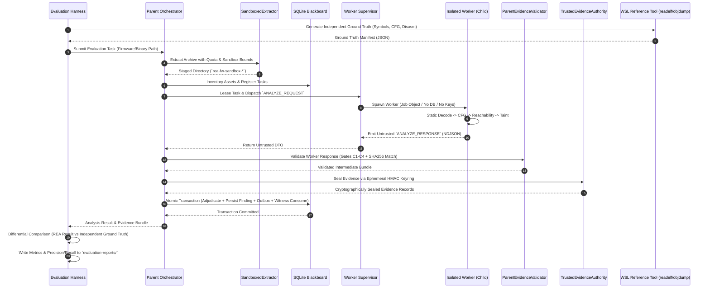

# REA Evaluation Laboratory Architecture & Isolation Specification
## Milestone 4.2 — Real-Input Validation Framework

**Document Version:** 1.0.0  
**Date:** November 2026  
**Status:** Approved Engineering Architecture  
**Role:** Senior Embedded Firmware Security Evaluation Engineer  
**Component:** `rea-evaluation-lab` / `rea-security-binary`  

---

## 1. Executive Overview & Mission

The **REA Evaluation Laboratory** (`REA-EVALUATION-LAB/`) is an external, isolated, structured testing and validation environment designed to assess the real-world accuracy, robustness, precision, and performance of REA against real firmware images, ELF binaries, vulnerable/patched software samples, and multiple processor architectures.

### 1.1 Core Principles
1. **Source Tree Isolation:** The evaluation laboratory resides entirely outside the production REA source repository (`c:\Users\acer\rea`). No third-party tools, vendor firmware images, or ephemeral analysis logs may be written into the production source tree.
2. **Production Pipeline Preservation:** All evaluation workflows must test the exact, unbypassed production architecture:
   $$\text{Firmware Ingestion} \longrightarrow \text{Extraction} \longrightarrow \text{Inventory} \longrightarrow \text{Task Scheduling} \longrightarrow \text{BinaryAnalysisWorker} \longrightarrow \text{Supervisor} \longrightarrow \text{Child Process} \longrightarrow \text{Parent Validator} \longrightarrow \text{Cryptographic Sealing} \longrightarrow \text{Adjudication} \longrightarrow \text{Transactional Outbox}$$
3. **Strict Fail-Closed Static Analysis:** Untrusted target binaries and extracted firmware root filesystems must **never** be executed directly on the host operating system. All analysis performed by REA is static by design. Any secondary dynamic validation (e.g., reference tool validation or witness verification) must execute only within disposable, unprivileged virtual containers with zero network access and strict time and resource ceilings.
4. **Epistemic Integrity:** Ground truth is established independently from external, trusted references (disassemblers, compiler debug info, CVE advisories, patch diffs). Unknown vulnerabilities are strictly recorded as *Unknown*, never claimed as *Absent* or *Clean*.
5. **Reproducibility & Auditability:** Every evaluation run must record the exact tool versions, hashes, configurations, stdout/stderr streams, resource consumption metrics, and intermediate evidence artifacts to ensure complete deterministic reproducibility.

---

## 2. Directory Layout & Storage Topology

The laboratory workspace is organized under `C:\Users\acer\REA-EVALUATION-LAB\` with twelve purpose-specific subdirectories:

```
REA-EVALUATION-LAB/
├── documentation/          # Evaluation charters, test protocols, procedures, standards
├── firmware-corpus/        # Vendor firmware images (.bin, .trx, .img, .chk, .pkg)
├── binary-corpus/          # Standalone ELF/PE executables across multiple architectures
├── vulnerability-corpus/   # Known vulnerable software samples and CVE benchmark suites
├── protection-corpus/      # Hardened samples (PIE, stack canary, RELRO, stripped, encrypted)
├── reference-tools/        # Independent reference binaries, scripts, and container harnesses
├── ground-truth/           # Authoritative ground-truth facts, symbol tables, and CFG manifests
├── execution-logs/         # Timestamped raw stdout/stderr logs and IPC transaction traces
├── raw-results/            # Raw JSON, SARIF, and DTO exports from REA analysis runs
├── resource-metrics/       # CPU, RSS memory, I/O, and execution time performance profiles
├── evaluation-reports/     # Generated validation reports, confusion matrices, and audits
└── regression-corpus/      # Minimized test cases from previous failures for regression prevention
```

### 2.1 Subdirectory Roles & Access Policies

| Directory | Content Type | Ingestion Policy | Retention Policy | Write Permissions |
|---|---|---|---|---|
| `documentation/` | Specifications, protocols, test plans | Version controlled | Permanent | Read-Write (Auditors) |
| `firmware-corpus/` | Compressed & raw firmware images | SHA-256 verified, signed manifest | Permanent (Pinned) | Read-Only (Staging only) |
| `binary-corpus/` | Real & synthetic ELF binaries | Strict manifest metadata required | Permanent (Pinned) | Read-Only (Workers) |
| `vulnerability-corpus/` | Paired vulnerable/patched samples | Ground-truth proven CVEs | Permanent (Pinned) | Read-Only (Workers) |
| `protection-corpus/` | Binaries with various mitigation flags | Documented toolchain provenance | Permanent (Pinned) | Read-Only (Workers) |
| `reference-tools/` | Extraction & disassembler wrappers | Verifiable scripts / Dockerfiles | Permanent | Read-Only during runs |
| `ground-truth/` | JSON/YAML fact manifests | Derived independently from REA | Permanent | Read-Only during runs |
| `execution-logs/` | Multi-process NDJSON & session traces | Created per evaluation run | 90 days / Archival | Append-Only (Parent) |
| `raw-results/` | Blackboard snapshots, SARIF, DTOs | Created per evaluation run | 90 days / Archival | Write-Once (Parent) |
| `resource-metrics/` | Time, CPU, memory, disk snapshots | Monitored per task & batch | Permanent | Append-Only (Harness) |
| `evaluation-reports/` | Precision/recall matrices, audits | Synthesized from raw results | Permanent | Read-Write (Auditors) |
| `regression-corpus/` | Minimized bug & edge-case samples | Extracted from evaluation failures | Permanent | Read-Write (Auditors) |

---

## 3. Host Architecture & Multi-Tier Execution Environment

The evaluation platform utilizes a hybrid Windows-Linux architecture to bridge native Windows host authority with Linux embedded toolchain support:

```
+---------------------------------------------------------------------------------------------------+
| WINDOWS 11 HOST (Primary Evaluation Platform)                                                     |
| Node.js 26.13.0 | npm 11.16.0 | Python 3.15.0 | Java 25.0.5 | w64devkit GCC 16.2 & Binutils 2.47  |
|                                                                                                   |
|  +---------------------------------------------------------------------------------------------+  |
|  | REA Production Orchestrator (Trusted Parent Process)                                         |  |
|  | - Firmware Ingestion & Staging                                                              |  |
|  | - FirmwareInventoryService & Asset Tree                                                     |  |
|  | - BinaryWorkerSupervisor (Windows Job Object Authority & Process Lifecycle)                |  |
|  | - ParentEvidenceValidator (Independent SHA-256 Hashing, Context Binding, Completeness)      |  |
|  | - TrustedEvidenceAuthority (HMAC-SHA256 Capability Signers & Ephemeral Keyrings)            |  |
|  | - VulnerabilityAdjudicationBridge (6-State Lifecycle Engine)                                |  |
|  | - SqliteBlackboardStorage & Transactional Outbox (Atomicity & Replay Protection)             |  |
|  +---------------------------------------------------------------------------------------------+  |
|                               |                                                                   |
|          (NDJSON stdio IPC)   |  Windows Job Object (Bounded Memory & Strict Timeout)             |
|                               v                                                                   |
|  +---------------------------------------------------------------------------------------------+  |
|  | REA Binary Analysis Worker (Isolated Child Process - Untrusted Sandbox)                     |  |
|  | - InProcessInstructionDecoder (x86-64, ARM32, Thumb, MIPS32 LE/BE)                         |  |
|  | - ControlFlowGraphBuilder & ReachabilityAnalyzer                                            |  |
|  | - TaintEngine & WitnessValidator                                                            |  |
|  | - Zero DB handles | Zero HMAC keys | Zero Sealing Authority                                 |  |
|  +---------------------------------------------------------------------------------------------+  |
+---------------------------------------------------------------------------------------------------+
                                ^
                                | WSL 2 Bridge / Volume Mount (`/mnt/c/Users/acer/REA-EVALUATION-LAB`)
                                v
+---------------------------------------------------------------------------------------------------+
| WSL 2 (Ubuntu 24.04 LTS / Linux 6.6 Kernel) — Independent Reference Validation Subsystem           |
|                                                                                                   |
|  +-------------------------------+  +-------------------------------+  +------------------------+  |
|  | GNU Binutils 2.42             |  | LLVM Disassembly Engine 18.1  |  | SquashFS Tools 4.6.1   |  |
|  | - readelf (ELF headers)       |  | - llvm-objdump-18             |  | - unsquashfs           |  |
|  | - objdump (Machine code)      |  | - Clang 18.1.3 Compiler       |  | - mksquashfs           |  |
|  | - strings & strip             |  | - Differential CFG GroundTruth|  | - Extraction Validator|  |
|  +-------------------------------+  +-------------------------------+  +------------------------+  |
|                                                                                                   |
|  +-------------------------------+  +-------------------------------+  +------------------------+  |
|  | Python 3.12.3 Environment     |  | Docker Engine (Isolated)      |  | Headless Ghidra / R2   |  |
|  | - Independent parsers         |  | - Network-isolated containers |  | - Standalone reference |  |
|  | - Differential test harnesses |  | - EMBA / Binwalk runners      |  |   ground-truth models  |  |
|  +-------------------------------+  +-------------------------------+  +------------------------+  |
+---------------------------------------------------------------------------------------------------+
```

### 3.1 Host Environment Responsibilities
1. **Windows Host Environment:** Hosts the authoritative REA code under evaluation, Node.js runtime, SQLite blackboard storage, and Windows Job Object supervisor. Child workers are spawned as native Windows processes managed under strict memory caps.
2. **WSL 2 Ubuntu Environment:** Serves as the **independent ground-truth generator**. Provides standard GNU and LLVM binutils, native filesystem extractors, and Linux toolchains to independently analyze binaries and generate ground-truth JSON fixtures without tainting REA's own logic.

---

## 4. Production Architecture Preservation

A foundational rule of this evaluation laboratory is that **no synthetic test harnesses or benchmark-only bypasses may substitute for production execution**.

### 4.1 Production Pipeline Trajectory
Every real-world sample evaluated in the laboratory must traverse the exact production pipeline:

```
[Target Firmware Image]
          │
          ▼
1. Ingestion & Validation
   - SHA-256 calculation & manifest verification
   - SandboxedExtractor (`src/security/firmware/SandboxedExtractor.ts`)
   - PreWriteValidator path traversal checks & archive quotas
          │
          ▼
2. Extracted Sandbox Staging
   - Hierarchy creation in `rea-fw-sandbox-*`
          │
          ▼
3. Inventory & Scheduling
   - FirmwareInventoryService (`src/security/firmware/FirmwareInventoryService.ts`)
   - ELF header parsing (`inspectBinaryHeader`)
   - Asset tree creation in SQLite blackboard
   - Task generation (`task_type: "binary_analysis"`)
          │
          ▼
4. Task Leasing & Supervision
   - BinaryAnalysisWorker (`src/application/security/workers/BinaryAnalysisWorker.ts`)
   - AgentWorker leases task with fencing token & CAS versioning
   - BinaryWorkerSupervisor (`src/security/binary/supervisor/BinaryWorkerSupervisor.ts`) spawns child process
          │
          ▼
5. Isolated Static Analysis (Child Process)
   - BinaryAnalysisWorkerProcess (`src/composition/binaryAnalysisWorkerProcess.ts`)
   - Pure static disassembly via InProcessInstructionDecoder
   - Control flow graph reconstruction, reachability analysis, taint tracing
   - Raw untrusted DTO returned over NDJSON stdio IPC
          │
          ▼
6. Parent Evidence Validation (Trusted Parent)
   - ParentEvidenceValidator (`src/security/binary/evidence/ParentEvidenceValidator.ts`)
   - Gate C1: Context binding verification
   - Gate C2: Independent SHA-256 hash recalculation from target bytes
   - Gate C3: DTO structural and canonical digest validation
   - Gate C4: Completeness invariant enforcement
          │
          ▼
7. Cryptographic Sealing
   - TrustedEvidenceAuthority (`src/security/binary/evidence/TrustedAnalysisEvidence.ts`)
   - Private HMAC-SHA256 capability signers sign stage evidence bundles
          │
          ▼
8. Multi-Stage Adjudication
   - VulnerabilityAdjudicationBridge (`src/security/binary/VulnerabilityAdjudicationBridge.ts`)
   - Strict 6-state lifecycle enforcement:
     CANDIDATE ──► INVESTIGATING ──► [INCONCLUSIVE | FALSE_POSITIVE | MITIGATED | VERIFIED]
          │
          ▼
9. Transactional Blackboard Persistence & Outbox
   - Atomic SQLite transaction: finding persisted + outbox event emitted + witness consumed
   - Replay protection across cold restarts verified
          │
          ▼
10. Reporting
    - SARIF / Markdown / JSON report generation via ReportGenerator & SarifExporter
```

### 4.2 Prohibited Shortcuts
The following practices are strictly forbidden during evaluation:
- **No Direct BenchmarkRunner Invocation:** `BenchmarkRunner` is a test-only fixture runner. It bypasses child process isolation, supervisor deadlines, parent hashing, and SQLite persistence.
- **No In-Process Bypass:** `BinaryAnalysisWorker` must be instantiated with a real `supervisor`, `validator`, and `authority`. The fallback path (`this.supervisor === undefined`) must not be used for evaluation benchmarks.
- **No Synthetic Evidence Injection:** Stage evidence must originate from the worker DTO and pass Gates C1–C4. No pre-signed evidence may be injected into adjudication.
- **No Authentication Disable Flags:** Adjudication must never run with test bypass symbols (`kInternalTestBypassSymbol`).

---

## 5. Security & Isolation Controls

Operating on third-party firmware images and untrusted binaries presents concrete security risks. The laboratory enforces eight defense-in-depth controls:

### 5.1 Static Analysis by Default
All binary inspection is strictly static. Binaries are parsed as raw byte buffers and disassembled into instruction streams. Neither the parent orchestrator nor the child worker executes target machine code, calls dynamic linkers, or invokes `execve` on target executables.

### 5.2 Child Process Sandbox Containment
- **Path Confinement:** `BinaryInputResolver` strictly validates that any target file path resides within `allowedRoot`. Attempts to escape the directory via directory traversal (`../`) or symlink indirection are rejected with `INPUT_RESOLVER_ROOT_ESCAPE`.
- **Privilege Stripping:** Worker processes inherit zero database handles, zero network sockets, and zero signing keys.
- **OS Resource Enforcement:** On Windows, processes are enrolled in a Windows Job Object configured with hard memory ceilings (`JobObjectExtendedLimitInformation`). On Linux/WSL, processes are governed by `prlimit` and V8 `--max-old-space-size`.

### 5.3 Archive Extraction Security (PreWriteValidator)
When extracting firmware archives (tar, zip, squashfs):
- **Path Traversal Defense:** Every archive entry path is canonicalized. Entries containing relative path segments (`..`), null bytes, or absolute path prefixes (`/`, `C:\`) are aborted.
- **Symlink & Hardlink Verification:** Symlinks pointing outside the sandbox root are rejected. Hardlinks referencing nonexistent or external inodes are rejected.
- **Quota & Bomb Mitigation:** Incremental byte quotas (`maxCumulativeBytes`) and file count caps (`maxFileCount`) are checked before allocating memory or writing to disk. Compression ratios exceeding 100:1 are aborted as decompression bombs.

### 5.4 Network Isolation (Air-Gap Simulation)
Evaluation runs must execute with external network access disabled:
- Evaluation harness scripts set `NODE_TLS_REJECT_UNAUTHORIZED=1` and bind mock network adapters or run offline.
- No dynamic CVE lookups or cloud telemetry may be triggered during an active assessment run. All intelligence databases (`cveDatabase`) are loaded from local pinned JSON mirrors in `REA-EVALUATION-LAB/ground-truth/`.

### 5.5 Secret & Credential Sanitization
- The evaluation laboratory contains zero production credentials, private SSH keys, or cloud access tokens.
- All HMAC keys used by `TrustedEvidenceAuthority` are generated ephemerally via `KeyringManager.createEphemeral(assessmentId)` and reside exclusively in volatile parent memory.

### 5.6 Execution Time Budgets & Deadlines
- Supervisor enforces hard task execution deadlines (`deadline: Date.now() + 15_000ms`).
- Unresponsive workers are subjected to immediate graceful cancellation (`CANCEL` message), followed by forced termination (`taskkill /PID <pid> /T /F` on Windows, `SIGKILL` on Linux) after a 1,000ms grace period.

---

## 6. Execution Lifecycle & Data Flow



---

## 7. Approval & Gate Invariants

Before any evaluation batch commences:
1. **Source Status Cleanliness:** The REA source code under evaluation must match the commit hash that passed `npm run check:fast` and binary security tests.
2. **Corpus Sanity:** Every sample in `firmware-corpus/` and `binary-corpus/` must have an associated, verified manifest entry in `ground-truth/manifests/`.
3. **Reference Tool Baseline:** All reference tools used for ground-truth comparison must report valid version and execution tests prior to evaluation.
4. **Cleanup Guarantee:** All ephemeral directories (`rea-fw-sandbox-*`) must be recursively deleted following task completion, retaining only the structured artifacts in `raw-results/` and `execution-logs/`.

