# REA Task 2C — Evaluation Corpus and Metric Discrepancy Audit

**Document ID:** REA-AUDIT-2C-001  
**Author:** Independent Firmware Security Evaluation Engineer & Binary-Analysis Benchmark Auditor  
**Date:** 2026-11-08  
**Scope:** REA Milestone 4.2 Task 2B Empirical Findings and Metric Reconciliation  
**Status:** Approved Audit Record  

---

## 1. Executive Summary

During the Milestone 4.2 Task 2B real-input evaluation, independent evaluation of REA against real-world binaries and firmware exposed five apparent metric discrepancies between high-level planning summaries, preliminary task notes, and empirical logs.

This audit establishes the rigorous mathematical definitions, experimental controls, and underlying structural causes for each metric, reconciling:
1. The **sample count taxonomy** (6 proposed classes vs. 7 primary physical inputs vs. 14 full-matrix artifacts);
2. The apparent paradox of **100% instruction boundary recall alongside 13.8%–30.0% semantic byte coverage** on RISC architectures;
3. The **denominator definition for byte coverage**, establishing why partial-traversal subsets must never serve as benchmark denominators;
4. The handling of **negative controls in vulnerability analysis (Track D)**, establishing why patched binary evaluation cannot be classified as a successful negative control when the positive sample is undetected;
5. The **exit code 0 behavior of the BusyBox CVE-2022-30065 reproducer**, explaining the mechanics of uninstrumented heap allocators and why clean exits do not prove security.

---

## 2. Discrepancy 1: Evaluation Corpus Sample Count Reconciliation

### 2.1 The Apparent Contradiction
- In initial planning documentation (`docs/rea-level-1-corpus-proposal.md`), the evaluation corpus was outlined as **6 sample classes**.
- In preliminary execution notes, an initial batch of **7 primary samples** was referenced.
- In the final Level-1 execution manifest (`level-1-execution-manifest.json`), exactly **14 physical artifacts** were staged and evaluated.

### 2.2 Reconciled Sample Architecture
The three numbers represent three distinct hierarchical layers of corpus design: **Logical Test Categories (6)**, **Primary Physical Samples (7)**, and the **Comprehensive Evaluation Matrix (14)**.

```mermaid
graph TD
    classDef cat fill:#e8f0fe,stroke:#1a73e8,stroke-width:2px;
    classDef prim fill:#e6f4ea,stroke:#137333,stroke-width:2px;
    classDef full fill:#fef7e0,stroke:#b06000,stroke-width:2px;

    C1["Category 1: ARM32"]:::cat --> P1["arm32_le_micro_auth_o0.elf"]:::prim
    C1 --> A1["arm32_le_micro_auth_o2.elf"]:::full
    C1 --> A2["arm32_le_micro_auth_o2_stripped.elf"]:::full

    C2["Category 2: ARM Thumb"]:::cat --> P2["arm_thumb_micro_auth_o0.elf"]:::prim

    C3["Category 3: MIPS32"]:::cat --> P3["mips_be_micro_auth_o0.elf"]:::prim
    C3 --> A3["mips_be_micro_auth_o2.elf"]:::full
    C3 --> A4["mips_le_micro_auth_o0.elf"]:::full
    C3 --> A5["mips_le_micro_auth_o2_stripped.elf"]:::full

    C4["Category 4: x86-64"]:::cat --> P4["x86_64_micro_auth_o0.elf"]:::prim
    C4 --> A6["micro_auth_hardened.elf"]:::full
    C4 --> A7["micro_auth_unprotected.elf"]:::full

    C5["Category 5: Firmware Rootfs"]:::cat --> P5["openwrt-23.05.0-ath79-generic-rootfs.squashfs"]:::prim

    C6["Category 6: Vulnerability Pair"]:::cat --> P6["busybox_1_35_0_unstripped (CVE)"]:::prim
    C6 --> P7["busybox_1_36_0_unstripped (Patched)"]:::prim
```



### 2.3 Detailed Accounting
1. **6 Logical Categories (Task 2A Planning)**:
   The conceptual proposal defined six target evaluation domains: (1) ARM32, (2) ARM Thumb, (3) MIPS32 Big-Endian, (4) x86-64, (5) Embedded Firmware SquashFS, and (6) BusyBox CVE-2022-30065 (grouped logically as a single comparative pair).
2. **7 Primary Physical Samples (Initial Execution Baseline)**:
   In rigorous physical testing, a comparative vulnerability pair cannot be treated as a single artifact. BusyBox 1.35.0 (vulnerable) and BusyBox 1.36.0 (fixed) are separate 2.5 MB ELF binaries compiled from distinct upstream trees. Counting each physical sample individually yields $5 + 2 = 7$ primary samples.
3. **14 Physical Artifacts (Full Verification Matrix)**:
   To evaluate specific technical failure modes discovered during testing—namely compiler optimization effects ($O0$ vs. $O2$), stripped symbol recovery (`FAIL-2B-004`), endianness divergence (MIPS BE vs. LE), and binary protection identification (Track E)—orthogonal artifacts were generated from the identical source baseline (`micro_auth.c`):
   - **Sample 1**: `arm32_le_micro_auth_o0.elf` (Track A Decoder Baseline)
   - **Sample 2**: `arm32_le_micro_auth_o2.elf` (Track B Optimization Analysis)
   - **Sample 3**: `arm32_le_micro_auth_o2_stripped.elf` (Track B Stripped Recovery Audit)
   - **Sample 4**: `arm_thumb_micro_auth_o0.elf` (Track A Mixed-Mode Thumb Analysis)
   - **Sample 5**: `mips_be_micro_auth_o0.elf` (Track A MIPS Big-Endian Baseline)
   - **Sample 6**: `mips_be_micro_auth_o2.elf` (Track B Branch Delay Slot Analysis)
   - **Sample 7**: `mips_le_micro_auth_o0.elf` (Track A MIPS Little-Endian Verification)
   - **Sample 8**: `mips_le_micro_auth_o2_stripped.elf` (Track B MIPS Stripped Recovery)
   - **Sample 9**: `x86_64_micro_auth_o0.elf` (Track A Variable-Length Decoding Baseline)
   - **Sample 10**: `openwrt-23.05.0-ath79-generic-rootfs.squashfs` (Track C Real Firmware Rootfs)
   - **Sample 11**: `busybox_1_35_0_unstripped` (Track D Vulnerable Ground Truth)
   - **Sample 12**: `busybox_1_36_0_unstripped` (Track D Patched Negative Baseline)
   - **Sample 13**: `micro_auth_hardened.elf` (Track E Hardened Security Baseline)
   - **Sample 14**: `micro_auth_unprotected.elf` (Track E Unprotected Baseline)

**Conclusion:** There is zero inconsistency. The 6-sample figure refers to abstract target categories; the 7-sample figure refers to the primary physical input batch; the 14-sample figure represents the complete physical artifact corpus required for comprehensive validation.

---

## 3. Discrepancy 2: Instruction Boundary Recall vs. Byte Coverage on RISC

### 3.1 The Observed Anomaly
In Track A, the MIPS32 and ARM32 evaluations yielded seemingly contradictory results:
- **Instruction Boundary Precision / Recall:** `100.0%`
- **Correct Byte Coverage:** `13.8%` (ARM32) and `30.0%` (MIPS32 BE)

### 3.2 Root Cause Analysis
This phenomenon is a direct consequence of the mathematical distinction between **topological alignment** and **semantic instruction decoding** on fixed-width architectures:

1. **Fixed 32-Bit Instruction Framing**:
   Both ARM32 (A32) and MIPS32 instructions are strictly 32 bits (4 bytes) wide, aligned on 4-byte boundaries ($\text{address} \equiv 0 \pmod 4$). Unlike x86-64, where an invalid opcode decode desynchronizes the instruction stream (causing variable-length misalignments of 1 to 15 bytes), a linear disassembler traversing ARM32 or MIPS32 will always land on legitimate 4-byte instruction start boundaries:
   $$\text{Boundary Recall} = \frac{|\text{Recovered Boundaries} \cap \text{Ground Truth Boundaries}|}{|\text{Ground Truth Boundaries in Traversed Region}|} = \frac{k}{k} = 100\%$$
2. **Semantic Instruction Stubbing in In-Process Decoder**:
   While REA correctly stepped by 4 bytes, its internal decoder (`InstructionDecoder.ts`) only recognized basic branch, jump, and direct-call patterns. For general computational instructions (arithmetic, logical, shifts, floating-point), REA emitted placeholder tokens:
   - Emitted mnemonic: `arm_inst` or `mips_inst`
   - Emitted operands: `""` (empty)
   - Instruction classification: `UNKNOWN_DATA_FLOW`
3. **Halt on Unrecognized Control Flow**:
   When REA encountered an unmodeled conditional branch or jump instruction, the recursive traversal halted prematurely, abandoning unreachable basic blocks.

### 3.3 Semantic Verification
Under the evaluation rubric:
- Emitting `arm_inst` at offset `0x10004` counts as a **correct boundary detection** (boundary recall = 100%).
- However, emitting a generic placeholder with missing mnemonic and operands is classified as an **unsupported/incorrect decode**.
- Therefore, semantic byte coverage was restricted to the tiny subset of recognized branches and calls ($13.8\%$ and $30.0\%$).

With the installation of Capstone 5.0.9 in Task 2C, semantic decoding replaces placeholder stubs, immediately elevating byte coverage from $13.8\%$ to **$99.24\%$** on ARM32 and from $30.0\%$ to **$100.0\%$** on MIPS32.

---

## 4. Discrepancy 3: Byte Coverage Denominator Definition

### 4.1 Strict vs. Relative Denominators
In naive binary-analysis reporting, tools often define byte coverage relative only to the subset of bytes the disassembler chose to inspect:
$$\text{Relative Coverage (Defective)} = \frac{\text{Bytes Decoded Correctly}}{\text{Bytes Examined by Tool}} \times 100\%$$
Under this defective metric, an x86 disassembler that decodes only the first 7 bytes of a binary before crashing would report $\frac{7}{7} = 100\%$ coverage.

### 4.2 Authoritative Denominator Formula Used in Task 2B
In REA Task 2B, the benchmark auditor strictly enforced an **authoritative ground-truth denominator**: the total executable byte size of the `.text` section extracted directly from the ELF Section Header Table (`sh_size`):

$$\text{Authoritative Byte Coverage} = \frac{\sum_{i \in \text{ValidDecodes}} \text{size}(i)}{\text{ELF Section Header Table } .text\text{ Size}} \times 100\%$$

Where:
- $\text{ValidDecodes} = \{i \mid \text{mnemonic}(i) = \text{ref\_mnemonic}(i) \land \text{operands}(i) = \text{ref\_operands}(i) \land \text{size}(i) = \text{ref\_size}(i)\}$
- Denominator = $S_{\text{text}} = \text{ELF}.sh\_hdr['.text'].sh\_size$

### 4.3 Concrete Corpus Computation
| Binary Artifact | $.text$ Section Size ($S_{\text{text}}$) | REA Decoded Bytes (Task 2B) | REA Coverage (Task 2B) | Capstone 5 Decoded Bytes (Task 2C) | Capstone 5 Coverage (Task 2C) |
| :--- | :---: | :---: | :---: | :---: | :---: |
| `x86_64_micro_auth_o0.elf` | 405 bytes | 7 bytes | **1.73%** | 405 bytes | **100.0%** |
| `arm32_le_micro_auth_o0.elf` | 528 bytes | 73 bytes | **13.83%** | 524 bytes | **99.24%** (1) |
| `arm_thumb_micro_auth_o0.elf` | 280 bytes | 40 bytes | **14.29%** | 276 bytes | **98.57%** (1) |
| `mips_be_micro_auth_o0.elf` | 756 bytes | 227 bytes | **30.03%** | 756 bytes | **100.0%** |
| `mips_le_micro_auth_o0.elf` | 756 bytes | 227 bytes | **30.03%** | 756 bytes | **100.0%** |

*(1) Note on ARM: The remaining 4 bytes represent inline literal-pool data (`.word` constants embedded in the code stream), correctly classified as data by Capstone.*

---

## 5. Discrepancy 4: Negative Controls in Vulnerability Evaluation (Track D)

### 5.1 Verification Logic for Comparative Security Testing
In vulnerability detection benchmarking, evaluating both a vulnerable target ($V$) and a patched target ($P$) requires a four-quadrant truth table:

| Target | True Status | Desired Engine Output | Observed REA Output (Task 2B) | Diagnostic Verdict |
| :--- | :--- | :--- | :--- | :--- |
| BusyBox 1.35.0 ($V$) | Vulnerable (CWE-416) | `VERIFIED` / Candidate Alert | `INCONCLUSIVE` (0 alerts) | **False Negative (`FAIL-2B-006`)** |
| BusyBox 1.36.0 ($P$) | Patched (Non-vulnerable) | `CLEAN` / Alert Suppressed | `INCONCLUSIVE` (0 alerts) | **Uninformative Inconclusive** |

### 5.2 Why BusyBox 1.36.0 Cannot Be Claimed as a "Negative Control Pass"
A negative control proves that a security tool does not produce false alarms on benign or patched code. However, for a test on $P$ to validate patch discrimination:
1. The tool **must first demonstrate detection capability** on $V$;
2. The tool must then demonstrate that the alert is specifically removed or suppressed on $P$ due to the patch.

Because REA's heuristic detector lacked a model for Heap Use-After-Free (CWE-416) entirely, it emitted zero candidates on both 1.35.0 and 1.36.0. Treating the absence of an alert on 1.36.0 as a "passed negative control" would commit the fallacy of affirming the consequent: an engine that detects nothing would achieve a 100% negative control score.

**Audit Conclusion:** Track D correctly recorded `FAIL-2B-006` (Vulnerability Miss) and flagged the negative control evaluation as uninformative pending implementation of a valid CWE-416 detector.

---

## 6. Discrepancy 5: Exit Code 0 on BusyBox CVE-2022-30065 Reproducer

### 6.1 Observed Execution
When the upstream proof-of-concept reproducer script (`crash2.awk`) was executed against the vulnerable BusyBox 1.35.0 binary in an uninstrumented Linux environment:
```bash
./busybox_1_35_0_unstripped awk -f crash2.awk
echo "Exit code: $?"
# Output: Exit code: 0
```
Both the vulnerable version (1.35.0) and the fixed version (1.36.0) exited cleanly with status code `0`.

### 6.2 Architectural Root Cause: Heap Latency and Non-Crashing UAF
CVE-2022-30065 is a Use-After-Free condition in BusyBox `awk`'s expression evaluation engine (`evaluate()` in `editors/awk.c`). Specifically, when evaluating an expression with `OC_MOVE`, an `rvalue` node is freed via `free_var()` while a stale pointer is subsequently accessed during assignment.

In standard userspace execution without memory sanitizers:
1. **Allocator Chunk Recycling**:
   When `free_var()` invokes `free()`, the glibc / musl memory allocator does not immediately unmap or zero the heap memory page. The chunk is merely placed on an internal bin or fastbin list.
2. **Silent Stale Access**:
   If the operating system kernel has not revoked read/write permissions on the virtual memory page containing the chunk, dereferencing the dangling pointer reads the existing memory bytes without triggering a hardware memory management fault (`SIGSEGV` or `SIGBUS`).
3. **Clean Termination**:
   Because `crash2.awk` completes execution and reaches `exit(0)` before memory corruption induces an invalid control flow transfer or corrupts heap metadata sufficiently to trigger `malloc()` abort checks, the process terminates with exit status `0`.

### 6.3 Audit Principle: Absence of Crash $\ne$ Absence of Vulnerability
A zero exit code on an uninstrumented binary proves only that the process did not crash; it does not prove the absence of memory corruption. Definite behavioral proof of a Use-After-Free requires:
- Compilation with AddressSanitizer (`-fsanitize=address`);
- Dynamic instrumentation via Valgrind / Dr. Memory; or
- Deliberate heap grooming that causes stale dereferences to strike unmapped memory.

In Milestone 4.3, dynamic witness generation must require ASAN-instrumented harnesses to validate memory-safety witnesses.

---

## 7. Audit Summary Table

| Discrepancy Topic | Initial Premise | Audit Finding & Resolution | Impact on REA Toolchain |
| :--- | :--- | :--- | :--- |
| **Corpus Sample Count** | 6 proposed vs. 7 primary vs. 14 matrix | 6 abstract classes; 7 physical artifacts in baseline; 14 total orthogonal variants in evaluation matrix. | Fully catalogued in `tools/manifest.json`. |
| **Boundary Recall vs. Byte Coverage** | 100% boundary recall with 13.8%–30.0% coverage | 4-byte RISC alignment ensures 100% boundary recall; low byte coverage caused by placeholder stubs (`arm_inst`). | Resolved by project-local Capstone 5.0.9 (99.2%–100% coverage). |
| **Byte Coverage Formula** | Ambiguity in denominator | Denominator strictly defined as total `.text` section size from ELF header table ($S_{\text{text}}$). | Adopted as permanent standard in `run_all_smoke_tests.py`. |
| **Negative Control Validity** | Patched 1.36.0 emitted zero alerts | Cannot claim negative control pass when positive baseline (1.35.0) is undetected due to missing CWE-416 model. | Requisite CWE-416 detection prioritized for Milestone 5. |
| **Reproducer Exit Code 0** | Clean exit on vulnerable binary | Heap allocator retained virtual page; clean exit without ASAN does not prove absence of vulnerability. | Requires ASAN harness for dynamic verification witnesses. |

---
**Verification Signature:**  
*Independent Benchmark Auditor & Systems Security Engineer*  
*Milestone 4.2 Audit Division*

